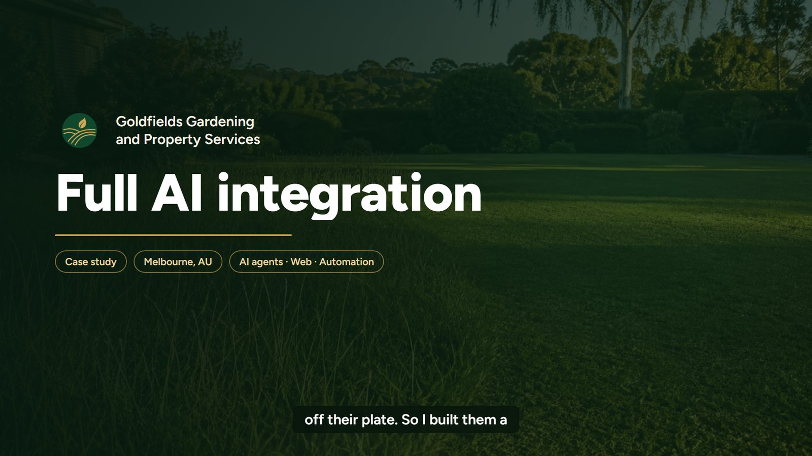
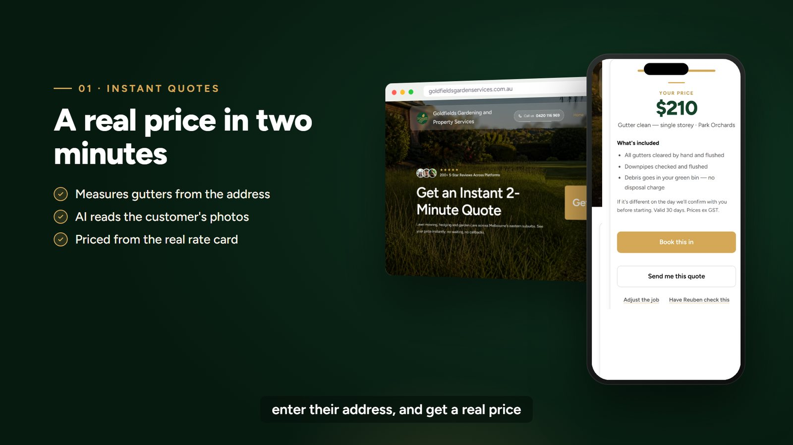
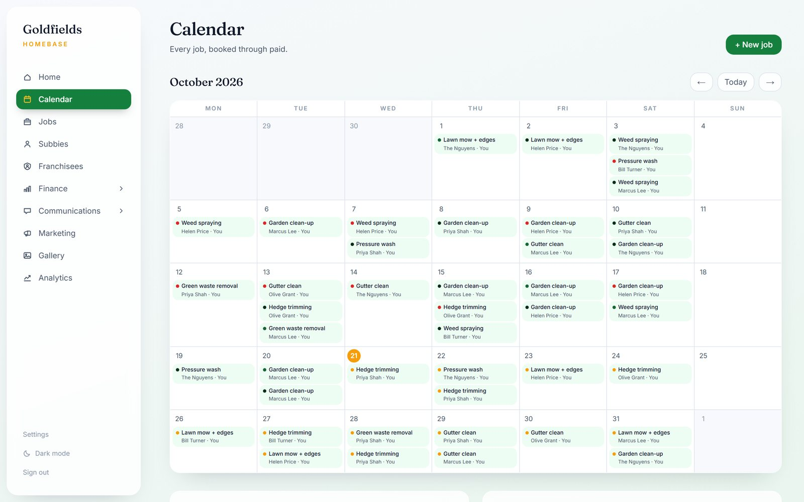
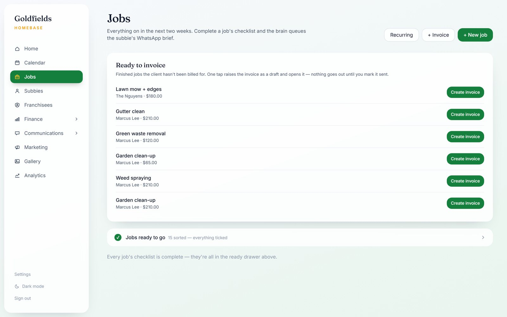
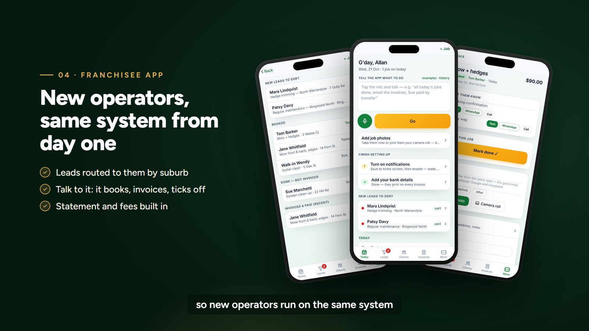
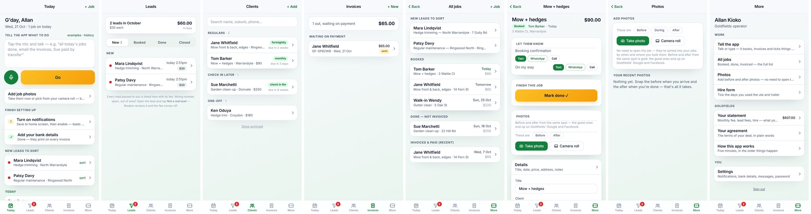
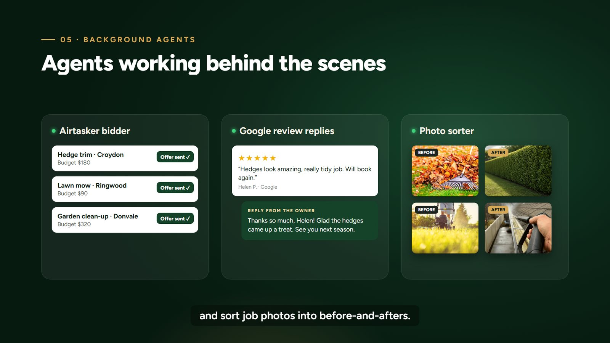
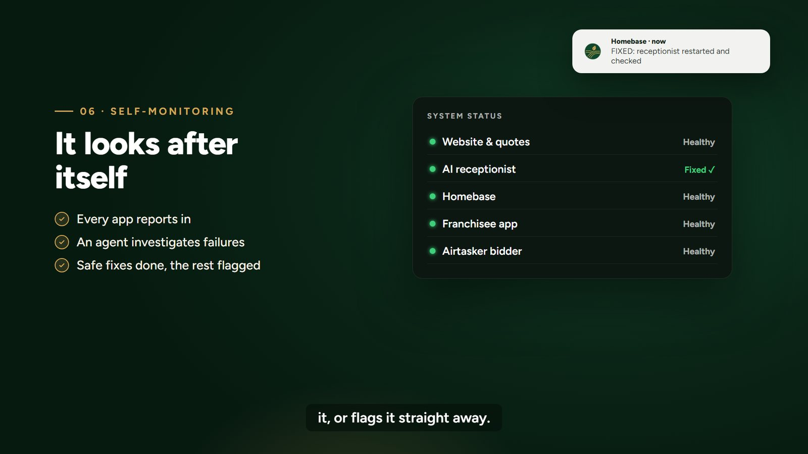
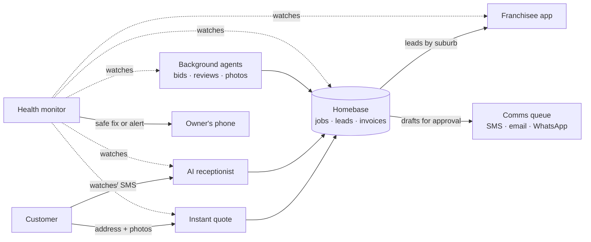

# Goldfields: full AI integration for a service business

**Case study.** The AI system I built and run for Goldfields Gardening and Property Services, a Melbourne garden and property business. The brief was simple: take the admin off the owner's plate so the business keeps running while everyone is out on the tools.

It runs the business day to day: quoting, answering the phone, booking jobs, invoicing, onboarding franchisees, and keeping an eye on itself.

▶ **[Watch the 60-second walkthrough](../../releases/latest)** (video in the latest release)

> The source code is private because it runs a live business and holds customer data. This repo is a write-up with screenshots. I'm happy to walk through the code on a call.

---

## What's in it

| Part | What it does |
|---|---|
| **2-minute instant quote** | A customer types their address and gets a real price on the page. The roof is measured from aerial imagery, AI reads any photos they upload, and the price comes from the business's real rate card. |
| **AI receptionist** | Answers every call and text, day or night. It knows the customer's history, books or captures the job, and routes the lead to the right person by suburb. |
| **Homebase dashboard** | One place for the whole business: calendar, jobs, subcontractors, franchisees, invoices, messages, marketing, photos and analytics. |
| **Franchisee app** | A phone app for new operators. Leads arrive routed by suburb, and you can *talk* to it ("all today's jobs done, email the invoices, Sue paid by transfer") to book, invoice and tick work off. Monthly statements and fees are built in. |
| **Background agents** | Bid on Airtasker jobs, draft replies to Google reviews, and sort job photos into before-and-after pairs for marketing. |
| **Self-monitoring** | Every app reports its health. When something fails, an agent investigates, applies safe fixes itself, and flags anything else straight away. |

## Screens

### Instant quote

### AI receptionist

### Homebase: the operations dashboard

### Franchisee app

### Agents behind the scenes

### It looks after itself

*Screens show demo data. No real customers appear.*

---

## How it fits together

A few design decisions that mattered:

- **A human approves anything that goes out.** Agents draft messages, invoices and review replies into an approvals queue. Nothing reaches a customer until someone taps approve, unless it's a routine message the owner has switched to automatic.
- **Prices come from the rate card, never from the model.** AI measures and reads; plain code does the pricing, so a quote can always be explained line by line.
- **One system for every operator.** Franchisees run on the same data and apps from day one, so the business grows without new admin.
- **Built to be left alone.** Health checks, automatic restarts and an investigating agent mean most faults are fixed before anyone notices.

## Built with

Claude (Anthropic) agents · Node.js · Next.js · SQLite · Twilio (voice and SMS) · Google Maps and aerial imagery · Playwright · a self-hosted Linux VPS behind Caddy, with pm2 process management

---

**Want something like this for your business?** Get in touch through my profile.
